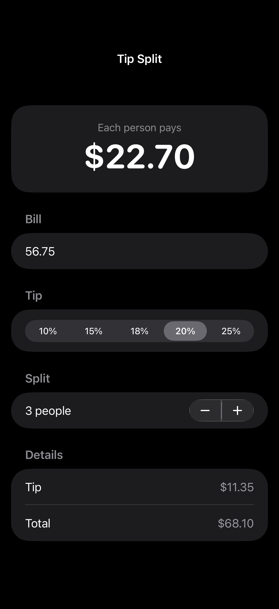

# Tip Split

A simple SwiftUI tip calculator. Enter the bill, pick a tip, and see what each person pays.

Built for Weekend 1 of my iOS Catch-Up Plan: getting back into iOS development with modern SwiftUI.

  

## Features

- **Live updates:** the total changes as you type, with no "calculate" button
- **Quick tip picks:** 10%, 15%, 18%, 20%, or 25%
- **Split the bill:** 1 to 20 people
- **Local currency:** amounts use your device's currency format
- **Safe input:** pasted negative numbers are treated as $0
- **Keyboard controls:** a Done button, and swipe down to dismiss
- **VoiceOver:** the "Each person pays" amount reads as one item
- **Dark Mode:** works out of the box

## How it works

The screen keeps just **3 pieces of state**: the bill text, the tip percent, and the number of people. Everything else (tip, total, per person) is computed from those, so the numbers can never get out of sync.

| SwiftUI piece | Used for |
| --- | --- |
| `Form`, `Section` | The grouped layout |
| `@State` | The 3 inputs |
| `@FocusState` | Hiding the keyboard |
| `TextField` with `.decimalPad` | Bill entry |
| `Picker` (segmented) | Tip percent |
| `Stepper` | Number of people |
| `LabeledContent` | Tip and total rows |
| `.contentTransition(.numericText())` | The animated main number |
| `#Preview` | Live previews in Xcode |

## Requirements

- Xcode with the iOS 27 SDK
- iOS 27 or later (iPhone or iPad)

## Run it

1. Clone the repo.
2. Open `TipSplit.xcodeproj` in Xcode.
3. Pick a simulator or your iPhone.
4. Press **Cmd + R**.

## What's next

- [ ] Move the math into a small `struct` and test it with Swift Testing (Weekend 5)
- [ ] Round so the split always adds up. Right now $100 split 3 ways is $33.33 each, which only totals $99.99.
